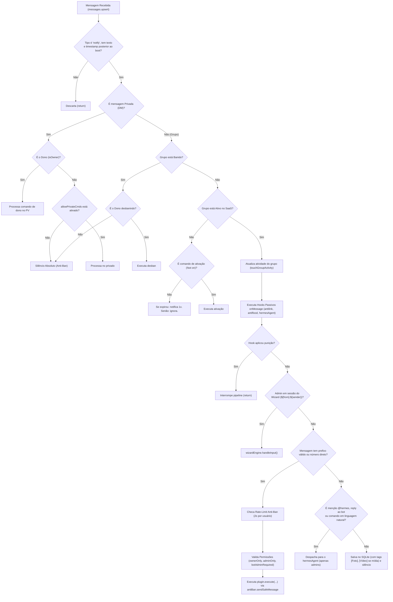

# 🗺️ Mapa Arquitetural do Projeto: WhatsApp Admin Bot (hermes.wpp)

> **Documento Canônico de Arquitetura e Engenharia de Software**  
> Este arquivo serve como mapa definitivo da base de código do bot WhatsApp para desenvolvedores e agentes de IA, descrevendo cada subsistema, fluxo de dados, contratos de interfaces, os 31 plugins, o motor de 24 ferramentas de IA e as regras de isolamento.

---

## 📌 1. Visão Geral do Sistema

* **Objetivo:** Bot de administração profissional para grupos de WhatsApp no modelo SaaS (assinatura mensal/vitalícia), com alta performance, baixo consumo de RAM, blindagem anti-ban e Agente de IA DeepSeek com Tool Calling determinístico.
* **Stack Tecnológico:**
  * **Runtime:** Node.js (Padrão CommonJS: `"type": "commonjs"`)
  * **Conexão WhatsApp:** `@whiskeysockets/baileys` (v6.7.9) sem `makeInMemoryStore`
  * **Cache em RAM:** `node-cache` (Singletons para metadados, wizard, antiflood e undo stack)
  * **Banco Local de Memória:** SQLite nativo via `node:sqlite` (`DatabaseSync`) em modo WAL
  * **Logs:** `pino` (Baixo consumo de I/O)
  * **Variáveis de Ambiente:** `dotenv`
  * **Process Manager:** PM2 (`ecosystem.config.js`)
* **Modelo de Persistência:** JSON Atômico em disco (`data/groups.json` e `data/polls.json`) sincronizado com `Map` em memória RAM (leitura $O(1)$) e escrita com debounce (`.tmp -> .bak -> .json`).

---

## 📂 2. Árvore de Diretórios e Responsabilidade dos Arquivos

```text
hermes.wpp/
├── data/                                 # Persistência JSON Atômica e SQLite (no .gitignore)
│   ├── groups.json                       # Whitelist de grupos, licenças SaaS, idioma, configs e cultura
│   ├── groups.json.bak                   # Backup automático anti-corrupção
│   ├── memory.db                         # SQLite ultraleve para buffer de contexto e busca por ref [mID]
│   └── polls.json                        # Persistência atômica de enquetes ativas e apuração de votos
├── src/
│   ├── auth/                             # Sessão de autenticação do Baileys (no .gitignore)
│   ├── config/
│   │   └── settings.js                   # Variáveis de ambiente (.env), números do dono e estado global
│   ├── core/
│   │   ├── connection.js                 # Socket Baileys, modo furtivo, reconexão e cache de grupo
│   │   ├── configManager.js              # Motor em RAM + Escrita Atômica (.tmp -> .json) + Merge Seguro
│   │   ├── wizardEngine.js               # Máquina de estados exclusiva por Admin (${from}:${sender})
│   │   ├── scheduler.js                  # Agendador de tarefas leves (horários, automsg, vencimentos)
│   │   ├── pluginLoader.js               # Carregador dinâmico de comandos (31), aliases (242) e schemas
│   │   └── setupWizard.js                # Wizard interativo de terminal CLI (1º boot)
│   ├── handlers/
│   │   ├── messageHandler.js             # Pipeline principal: early-return, licença, wizard e comandos
│   │   └── groupHandler.js               # Eventos group-participants.update (welcome, antifake, blacklist)
│   ├── plugins/                          # 31 Módulos Plug-and-Play desacoplados
│   │   ├── admin/                        # 25 Plugins de Gestão e Moderação
│   │   │   ├── config.js                 # Painel Interativo Geral (!config / !painel / !settings)
│   │   │   ├── lang.js                   # Troca de idioma rápida (!idioma / !lang / !language)
│   │   │   ├── antilink.js               # Filtro de links com whitelist de domínios
│   │   │   ├── welcome.js                # Boas-vindas automáticas com auto-delete opcional
│   │   │   ├── warn.js                   # Sistema de advertências progressivas (1/3 -> Ban)
│   │   │   ├── antiflood.js              # Anti-spam de mensagens seguidas e anti-trava
│   │   │   ├── antifake.js               # Bloqueio de números estrangeiros por DDI
│   │   │   ├── schedule.js               # Agendamento diário de abrir/fechar grupo
│   │   │   ├── automsg.js                # Mensagens periódicas inteligentes (só envia se ativo)
│   │   │   ├── ban.js                    # Remoção imediata de participante
│   │   │   ├── mute.js                   # Fechar e abrir grupo imediatamente
│   │   │   ├── hidetag.js                # Marcação oculta de todos os membros do grupo
│   │   │   ├── promote.js                # Promover membro a administrador
│   │   │   ├── demote.js                 # Rebaixar administrador a membro comum
│   │   │   ├── clear.js                  # Apagar mensagem respondida (!del)
│   │   │   ├── blacklist.js              # Lista negra do grupo e global
│   │   │   ├── raffle.js                 # Sorteio aleatório entre membros (!sortear)
│   │   │   ├── calendar.js               # Agenda e agendamento de ações futuras (abrir, fechar, lembrete)
│   │   │   ├── link.js                   # Obtenção e revogação do link oficial de convite do grupo
│   │   │   ├── mutemember.js             # Silenciamento temporário individual de membro (até 24h)
│   │   │   ├── pin.js                    # Fixação temporária de mensagem (24h, 7d, 30d) e desfixação
│   │   │   ├── poll.js                   # Criação e apuração de enquetes interativas
│   │   │   ├── setdesc.js                # Alteração da descrição e regras do grupo
│   │   │   ├── setpic.js                 # Alteração da imagem de perfil do grupo
│   │   │   └── hermesAgent.js            # [Agente IA] Plugin do Agente com 24 Tools, Prefix Cache e Undo
│   │   ├── general/                      # 2 Plugins Gerais
│   │   │   ├── menu.js                   # Menu interativo de comandos por número e categoria
│   │   │   └── ping.js                   # Status, latência em ms, RAM e validade da licença
│   │   └── owner/                        # 4 Plugins Exclusivos do Dono
│   │       ├── groupAuth.js              # Gestão SaaS (!bot on, !bot add, !bot off, !pv)
│   │       ├── reload.js                 # Hot-reload de plugins e traduções em tempo real
│   │       ├── autoAdm.js                # Auto-promoção do Dono a Admin no grupo
│   │       └── banGroup.js               # Bloqueio e desbloqueio remoto de grupos abusivos
│   ├── services/                         # [Camada de IA - Estritamente Confinada e Desacoplada]
│   │   ├── aiService.js                  # Cliente DeepSeek HTTP oficial com System Prompt 100% estático
│   │   ├── humanizer.js                  # Centralização de humanização textual (WhatsApp PT-BR real)
│   │   ├── memoryEngine.js               # SQLite WAL com mídias ([Foto], [Vídeo]), buffer e refs [mID]
│   │   ├── timeParser.js                 # Parser de horários relativos e absolutos (amanhã, às 20h, dq a 15m)
│   │   └── toolRegistry.js               # Mapeamento e despacho determinístico das 24 Ferramentas
│   └── utils/
│       ├── antiBan.js                    # Presença furtiva, jitter delay, "digitando..." e cooldown
│       ├── cache.js                      # Instâncias de cache (groupCache, wizardCache, floodCache)
│       ├── i18n.js                       # Motor nativo de internacionalização (PT / ES / EN)
│       ├── i18nFormal.js                 # Adaptações lexicais para personalidade formal
│       ├── jidResolver.js                # Resolução de JIDs, @lid, menções, quotes e nono dígito BR
│       ├── logger.js                     # Instância do Pino configurada para baixo I/O
│       ├── pinTracker.js                 # Rastreamento e desfixação de mensagens fixadas no WhatsApp
│       └── pollTracker.js                # Rastreamento de enquetes ativas e apuração de votos
├── .agents/
│   ├── rules/
│   │   └── regras.md                     # Regras invioláveis de arquitetura, anti-ban e isolamento
│   └── skills/
│       └── hermes-wpp-map/SKILL.md       # Este mapa arquitetural canônico
├── .env.example                          # Template de variáveis de ambiente
├── .gitignore                            # Ignora node_modules, src/auth, data/ e .env
├── ecosystem.config.js                   # Configuração de deploy para PM2
├── gemini.md                             # Especificação técnica original do projeto
├── index.js                              # Entrypoint: setupWizard, boot do Baileys e Graceful Shutdown
└── package.json                          # Dependências enxutas (Padrão CommonJS: "type": "commonjs")
```

---

## ⚡ 3. Pipeline do Manipulador de Mensagens (`src/handlers/messageHandler.js`)

Cada mensagem recebida atravessa um pipeline rigoroso de early-returns e validações determinísticas:



---

## 🧠 4. Regras Fundamentais: Agente de IA Hermes & DeepSeek

1. **Confinamento Total:** O motor de IA é restrito a `src/plugins/admin/hermesAgent.js` e à camada `src/services/`.
2. **Zero Invasão no Core:** Nenhum arquivo do núcleo (`src/core/`), handlers de eventos (`src/handlers/groupHandler.js`) ou utilitários fundamentais faz chamadas à API da DeepSeek.
3. **Segurança Determinística (Anti-Prompt Injection):** O modelo sugere ferramentas via Function Calling, mas a validação de privilégios (`checkAdminStatus`), resoluções de número/@lid e execuções no Baileys ocorrem exclusivamente em Node.js.
4. **Estratégia de Prefix Caching Global (DeepSeek):**
   * O `buildSystemPrompt()` em `aiService.js` é **100% estático**, contendo apenas as diretrizes imutáveis e personas.
   * O nome e o prefixo do grupo são injetados em `userPromptParts` (no corpo da mensagem do usuário).
   * Com isso, o bloco inicial:
     $$\text{System Prompt (Estático)} + \text{24 Schemas de Ferramentas} \approx 7.200\text{ tokens}$$
     permanece idêntico para qualquer grupo, atingindo **até 90% de desconto de cache hit** na DeepSeek.
5. **Histórico com Tags de Mídia:** Mensagens sem legenda recebidas no grupo são gravadas com identificadores (`[Foto]`, `[Vídeo]`, `[Figurinha]`, `[Áudio]`, `[Documento]`) no SQLite com seu `msgId` e participante, permitindo moderação contextual por referência `[mID]`.
6. **Pilha de Desfazer (`undo_stack`):** O conjunto `REVERSIBLE_TOOLS` rastreia alterações de módulos (`toggle_group_protection`), silenciamentos (`mute_member`), tranca de grupo (`set_group_mute`), advertências (`warn_member`), promoções, rebaixamentos, descrições e fixações, permitindo que o admin desfaça comandos anteriores dizendo *"Hermes, desfaz isso"*.

---

## 🛠️ 5. Catálogo Completo das 24 Ferramentas (Tool Calling)

| # | Ferramenta (Tool Call) | Plugin / Serviço | Ação Executada | Validação |
| :-: | :--- | :--- | :--- | :--- |
| 1 | `ban_member` | `ban.js` | Remove participante do grupo | Admin |
| 2 | `set_group_mute` | `mute.js` | Tranca ou abre o grupo (imediato ou agendado) | Admin |
| 3 | `set_group_schedule` | `schedule.js` | Configura horários diários automáticos para abrir/fechar | Admin |
| 4 | `toggle_group_protection` | `config.js` / plugins | Ativa, desativa ou ajusta plugins de segurança | Admin |
| 5 | `warn_member` | `warn.js` | Aplica advertência progressiva (1/3 -> Ban) | Admin |
| 6 | `unwarn_member` | `warn.js` | Remove 1 advertência de um participante | Admin |
| 7 | `list_group_warns` | `warn.js` | Lista os membros advertidos e motivos | Admin |
| 8 | `delete_message` | `clear.js` | Apaga mensagem do chat (por citação ou ref `mID`) | Admin |
| 9 | `hidetag_announcement` | `hidetag.js` | Menciona todos os membros de forma invisível | Admin |
| 10 | `promote_member` | `promote.js` | Promove participante a administrador | Admin |
| 11 | `demote_member` | `demote.js` | Rebaixa administrador a membro comum | Admin |
| 12 | `mute_member` | `mutemember.js` | Silencia participante individualmente no chat (até 24h) | Admin |
| 13 | `unmute_member` | `mutemember.js` | Remove silenciamento de participante | Admin |
| 14 | `get_group_invite_link` | `link.js` | Obtém ou revoga link de convite oficial | Admin |
| 15 | `raffle_members` | `raffle.js` | Realiza sorteio aleatório entre membros | Admin |
| 16 | `pin_group_message` | `pin.js` | Fixa mensagem por 24h, 7d, 30d ou desfixa todas | Admin |
| 17 | `set_group_picture` | `setpic.js` | Atualiza a foto de perfil do grupo | Admin |
| 18 | `set_group_description` | `setdesc.js` | Atualiza a descrição/regras do grupo | Admin |
| 19 | `create_group_poll` | `poll.js` | Cria enquete oficial com 2 a 12 opções | Admin |
| 20 | `get_poll_results` | `poll.js` | Consulta placar, votos e vencedor da enquete | Admin |
| 21 | `manage_calendar` | `calendar.js` | Agenda eventos e ações temporizadas no futuro | Admin |
| 22 | `learn_group_fact` | `configManager.js` | Aprende regras tácitas, apelidos ou tom cultural | Admin |
| 23 | `forget_group_fact` | `configManager.js` | Esquece fatos ou regras aprendidas | Admin |
| 24 | `manage_blacklist` | `blacklist.js` | Adiciona ou remove números da lista negra | Admin |

---

## 💾 6. Esquema de Persistência (`data/groups.json`)

```json
{
  "_global": {
    "allowPrivateCmds": false,
    "blacklist": ["5511900000000@s.whatsapp.net"]
  },
  "120363000000000@g.us": {
    "enabled": true,
    "lang": "pt",
    "prefix": "!",
    "expiresAt": 1790000000000,
    "expiryNotified": false,
    "lastActivity": 1710000000000,
    "blacklist": [],
    "warns": {
      "5511988888888@s.whatsapp.net": 1
    },
    "culture": {
      "vibe": "descontraida",
      "tone": "amigavel",
      "rules": ["proibido brigas de politica"],
      "facts": { "lucas": "moderador do turno da noite" }
    },
    "plugins": {
      "antilink": {
        "enabled": true,
        "configured": true,
        "allowedDomains": ["youtube.com", "instagram.com"],
        "action": "delete"
      },
      "hermes": {
        "enabled": true,
        "configured": true,
        "personality": "descontraido",
        "memoryEnabled": true
      }
    }
  }
}
```

---

## 🛡️ 7. Blindagem Anti-Ban & Performance

* **Furtividade de Presença:** `markOnlineOnConnect: false` no Baileys. O bot mantém presença `unavailable` e só envia `composing` durante a simulação de digitação.
* **Jitter Proporcional:** Delay de leitura aleatório (300-700ms) + digitação proporcional ao tamanho da resposta (600ms a 2200ms).
* **Escalonamento no Scheduler:** Tarefas em massa (ex: fechar 10 grupos às 23h) rodam em fila sequencial com intervalo aleatório de 1.5s a 3.5s entre grupos.
* **Gravação Atômica com Debounce:** Escritas no disco têm debounce de 1000ms e passam por arquivo temporário (`.tmp -> .bak -> .json`), com `flushSync()` no SIGINT/SIGTERM.
* **Rate-Limit por Usuário:** Cooldown determinístico de 2 segundos para impedir disparo de comandos em sequência rápida.
