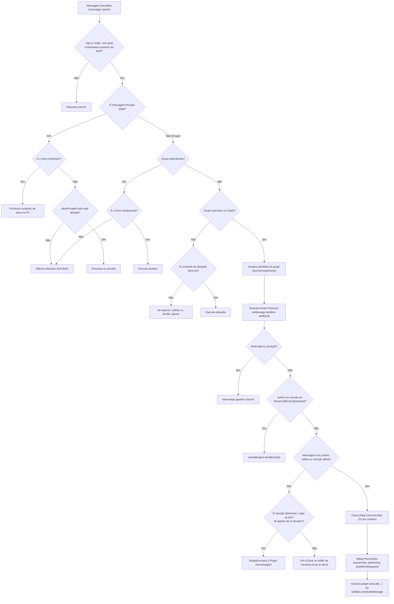

# 🗺️ Mapa Arquitetural do Projeto: WhatsApp Admin Bot (hermes.wpp)

> **Documento Canônico de Arquitetura e Engenharia de Software**  
> Este arquivo serve como mapa definitivo da base de código do bot WhatsApp para desenvolvedores e agentes de IA, descrevendo cada subsistema, fluxo de dados, contratos de interfaces e regras de isolamento.

---

## 📌 1. Visão Geral do Sistema

* **Objetivo:** Bot de administração profissional para grupos de WhatsApp no modelo SaaS (assinatura mensal/vitalícia), com alta performance, baixo consumo de RAM, blindagem anti-ban e suporte opcional a Agente de IA isolado.
* **Stack Tecnológico:**
  * **Runtime:** Node.js (Padrão CommonJS: `"type": "commonjs"`)
  * **Conexão WhatsApp:** `@whiskeysockets/baileys` (v6.7.9) sem `makeInMemoryStore`
  * **Cache em RAM:** `node-cache` (Singletons para metadados, wizard e antiflood)
  * **Logs:** `pino` (Baixo consumo de I/O)
  * **Variáveis de Ambiente:** `dotenv`
  * **Process Manager:** PM2 (`ecosystem.config.js`)
* **Modelo de Persistência:** JSON Atômico em disco (`data/groups.json`) sincronizado com `Map` em memória RAM (leitura $O(1)$).

---

## 📂 2. Árvore de Diretórios e Responsabilidade dos Arquivos

```text
hermes.wpp/
├── data/                                 # Persistência JSON Atômica (no .gitignore)
│   ├── groups.json                       # Whitelist de grupos, licenças SaaS, idioma e configs
│   ├── groups.json.bak                   # Backup automático anti-corrupção
│   └── memory.db                         # [Opcional IA] SQLite ultraleve para buffer de contexto
├── src/
│   ├── auth/                             # Sessão de autenticação do Baileys (no .gitignore)
│   ├── config/
│   │   └── settings.js                   # Variáveis de ambiente (.env), números do dono e estado global
│   ├── core/
│   │   ├── connection.js                 # Socket Baileys, modo furtivo, reconexão e cache de grupo
│   │   ├── configManager.js              # Motor em RAM + Escrita Atômica (.tmp -> .json) + Merge Seguro
│   │   ├── wizardEngine.js               # Máquina de estados exclusiva por Admin (${from}:${sender})
│   │   ├── scheduler.js                  # Agendador de tarefas leves (horários, automsg, vencimentos)
│   │   ├── pluginLoader.js               # Carregador dinâmico de comandos, aliases e schemas
│   │   └── setupWizard.js                # Wizard interativo de terminal CLI (1º boot)
│   ├── handlers/
│   │   ├── messageHandler.js             # Pipeline principal: early-return, licença, wizard e comandos
│   │   └── groupHandler.js               # Eventos group-participants.update (welcome, antifake, blacklist)
│   ├── plugins/                          # Módulos Plug-and-Play desacoplados
│   │   ├── admin/                        # 17 Plugins de Gestão e Moderação
│   │   │   ├── config.js                 # Painel Interativo Geral (!config / !painel)
│   │   │   ├── lang.js                   # Troca de idioma rápida (!idioma / !lang)
│   │   │   ├── antilink.js               # Filtro de links com whitelist de domínios
│   │   │   ├── welcome.js                # Boas-vindas automáticas com auto-delete opcional
│   │   │   ├── warn.js                   # Sistema de advertências progressivas (1/3 -> Ban)
│   │   │   ├── antiflood.js              # Anti-spam de mensagens seguidas e anti-trava
│   │   │   ├── antifake.js               # Bloqueio de números estrangeiros por DDI
│   │   │   ├── schedule.js               # Agendamento diário de abrir/fechar grupo
│   │   │   ├── automsg.js                # Mensagens periódicas inteligentes (só envia se ativo)
│   │   │   ├── ban.js                    # Remoção imediata de participante
│   │   │   ├── mute.js                   # Fechar e abrir grupo imediatamente
│   │   │   ├── hidetag.js                # Marcação oculta de todos os membros do grupo
│   │   │   ├── promote.js                # Promover membro a administrador
│   │   │   ├── demote.js                 # Rebaixar administrador a membro comum
│   │   │   ├── clear.js                  # Apagar mensagem respondida (!del)
│   │   │   ├── blacklist.js              # Lista negra do grupo e global
│   │   │   ├── raffle.js                 # Sorteio aleatório entre membros (!sortear)
│   │   │   └── hermesAgent.js            # [Agente IA] Plugin opcional do Agente com Tool Calling
│   │   ├── general/                      # 2 Plugins Gerais
│   │   │   ├── menu.js                   # Menu rápido de comandos
│   │   │   └── ping.js                   # Status, latência em ms, RAM e validade da licença
│   │   └── owner/                        # 4 Plugins Exclusivos do Dono
│   │       ├── groupAuth.js              # Gestão SaaS (!bot on, !bot add, !bot off, !pv)
│   │       ├── reload.js                 # Hot-reload de plugins e traduções em tempo real
│   │       ├── autoAdm.js                # Auto-promoção do Dono a Admin
│   │       └── banGroup.js               # Banir/Desbanir grupo remotamente
│   ├── services/                         # [Camada Opcional de IA - Estritamente Isolada]
│   │   ├── aiService.js                  # Cliente OpenRouter / DeepSeek com streaming e tools
│   │   ├── memoryEngine.js               # Buffer deslizante local e dossiê de contexto
│   │   └── toolRegistry.js               # Mapeamento dos plugins existentes em schemas de Tool Calling
│   └── utils/
│       ├── antiBan.js                    # Presença furtiva, jitter delay, "digitando..." e cooldown
│       ├── i18n.js                       # Motor nativo de internacionalização (PT / ES / EN)
│       ├── jidResolver.js                # Resolução de JIDs, @lid, menções, quotes e nono dígito BR
│       ├── logger.js                     # Instância do Pino configurada para baixo I/O
│       └── cache.js                      # Instâncias de cache (groupCache, wizardCache, floodCache)
├── .agents/
│   ├── rules/
│   │   └── ai-plugin-boundary.md         # Regra estrita de isolamento de IA
│   └── skills/
│       └── hermes-wpp-map/SKILL.md       # Este mapa do projeto
├── .env.example                          # Template de variáveis de ambiente
├── .gitignore                            # Ignora node_modules, src/auth, data/ e .env
├── ecosystem.config.js                   # Configuração de deploy para PM2
├── gemini.md                             # Especificação técnica mestre do projeto
├── index.js                              # Entrypoint: setupWizard, boot do Baileys e Graceful Shutdown
└── package.json                          # Dependências e scripts CommonJS
```

---

## ⚡ 3. Pipeline do Manipulador de Mensagens (`src/handlers/messageHandler.js`)

Cada mensagem recebida atravessa um pipeline rigoroso de early-returns e validações determinísticas:



---

## 🧠 4. Regra Fundamental: Isolamento do Agente de IA

Para manter a integridade, velocidade e segurança da infraestrutura:

1. **Confinamento em Plugin:** O motor de IA é um plugin opcional (`src/plugins/admin/hermesAgent.js`).
2. **Zero Invasão no Core:** Nenhum arquivo em `src/core/`, `src/handlers/groupHandler.js` ou `src/utils/` faz chamadas à API de IA.
3. **Proteção Rápida Mantida:** Filtros como `antilink.js` e `antiflood.js` continuam rodando em 15ms via código determinístico.
4. **Tool Calling Seguro:** O modelo sugere a ação (`ban_member`, `mute_group`), mas quem valida as permissões de admin e executa é o código Node.js.
5. **Independência Operacional:** Se a API de IA falhar ou ficar sem créditos, o bot continua 100% funcional nos comandos tradicionais.

---

## 💾 5. Esquema de Persistência (`data/groups.json`)

```json
{
  "_global": {
    "allowPrivateCmds": false,
    "blacklist": ["5511900000000@s.whatsapp.net"]
  },
  "120363000000000@g.us": {
    "enabled": true,
    "lang": "pt",
    "prefix": "!",
    "expiresAt": 1790000000000,
    "expiryNotified": false,
    "lastActivity": 1710000000000,
    "blacklist": [],
    "warns": {
      "5511988888888@s.whatsapp.net": 1
    },
    "plugins": {
      "antilink": {
        "enabled": true,
        "configured": true,
        "allowedDomains": ["youtube.com", "instagram.com"],
        "action": "delete"
      },
      "hermesAgent": {
        "enabled": true,
        "configured": true,
        "personality": "descontraido",
        "memoryEnabled": true
      }
    }
  }
}
```

---

## 🛡️ 6. Blindagem Anti-Ban & Performance

* **Furtividade de Presença:** `markOnlineOnConnect: false` no Baileys. O bot mantém status `unavailable` e só envia `composing` durante a simulação de digitação.
* **Jitter Proporcional:** Delay de leitura aleatório (300-700ms) + digitação proporcional ao tamanho da resposta (600ms a 2200ms).
* **Escalonamento no Scheduler:** Tarefas em massa (ex: fechar 10 grupos às 23h) rodam em fila sequencial com intervalo aleatório de 1.5s a 3.5s entre grupos.
* **Gravação Atômica com Debounce:** Escritas no disco têm debounce de 1000ms e passam por arquivo temporário (`.tmp -> .bak -> .json`), com `flushSync()` no SIGINT/SIGTERM.
